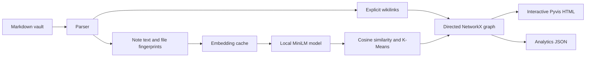

# Second Brain Graph

**A local-first knowledge graph for Markdown vaults.** Explore explicit
Obsidian wikilinks, find likely related notes with local sentence embeddings,
trace directed paths, and export graph data for further analysis.

It turns a folder of notes into a portable interactive HTML map. Note contents
are processed on your machine; the first semantic run downloads the selected
model from Hugging Face, then uses the local model and embedding cache.

## Highlights

- **Explicit links:** directed `[[wikilinks]]`, unresolved references, aliases,
  heading fragments, and folder-qualified targets.
- **Local semantic discovery:** `all-MiniLM-L6-v2` suggestions with a
  configurable cosine threshold and incremental, content-verified caching.
- **Topic colors:** up to five K-Means clusters make related note vectors easy
  to distinguish in the graph.
- **Graph-RAG retrieval:** a local query returns its three closest note seeds
  and their direct explicit-link neighbors.
- **Graph exploration:** search, open-reference/orphan/hub filters, an inbound
  and outbound inspector, semantic-match scores, and shortest explicit-link
  route tracing.
- **Readable graph styling:** blue solid wikilinks, muted dashed semantic
  suggestions, unresolved targets, and a switch to hide semantic edges.
- **Useful analysis:** PageRank, explicit-link density, reciprocal links,
  orphan notes, unresolved references, and top-note rankings.
- **Portable outputs:** self-contained HTML plus an optional versioned JSON
  graph export. Generated artifacts use vault-relative note paths.
- **Incremental runs:** unchanged note embeddings are reused; edits and new
  notes are embedded without rebuilding every vector.

## Quick start

Requires Python 3.10 or newer. From the project directory:

```powershell
python -m pip install -r requirements.txt
python main.py build .\demo_notes --output .\index.html --json-output .\graph.json
```

Open `index.html` in a browser. The first run downloads the MiniLM model and
may take longer; later runs reuse it and the vault cache. The included demo
has two related notes without wikilinks between them, so the semantic suggestion is
visible at the default `0.75` threshold.

To generate a graph for your own vault:

```powershell
python main.py build "C:\path\to\your\vault" `
  --output .\build\vault-graph.html `
  --json-output .\build\vault-graph.json
```

Search for a concept and retrieve the three closest notes plus their direct
explicit wikilink neighbors:

```powershell
python main.py search "distributed systems" --directory "C:\path\to\your\vault"
```

On Windows, `setup_and_run.ps1` bootstraps a project-local Python runtime,
installs dependencies, and builds the demo:

```powershell
.\setup_and_run.ps1
```

To use that runtime with another vault:

```powershell
.\setup_and_run.ps1 -VaultPath "C:\path\to\your\vault" `
  -OutputPath ".\build\vault-graph.html"
```

## CLI options

```text
python main.py build [DIRECTORY] [--output HTML]
  [--json-output JSON]
  [--similarity-threshold 0..1]
  [--model MODEL_ID_OR_LOCAL_PATH]
  [--cache CACHE_JSON]
  [--exclude-dir NAME ...]
  [--no-semantic]

python main.py search QUERY [--directory DIRECTORY]
  [--model MODEL_ID_OR_LOCAL_PATH]
  [--cache CACHE_JSON]
  [--exclude-dir NAME ...]
```

- `--similarity-threshold` defaults to `0.75`. Lower it to discover broader
  relationships; raise it to show only closer matches.
- `--model` defaults to `all-MiniLM-L6-v2`. It accepts a Hugging Face model ID
  or a local Sentence Transformers model directory.
- `--cache` defaults to `<vault>/.second_brain/embeddings.json`.
- `--exclude-dir` adds directory names to the default exclusions (`.git`,
  `.obsidian`, `.second_brain`, `.trash`, `.venv`, `venv`, and `node_modules`).
- `--no-semantic` skips embedding-based links and clustering for a lightweight
  explicit-only build. Normal builds and searches use local embeddings.
- `build` and `search` default to the included `demo_notes` folder; pass a vault
  path to `build` or use `--directory` with `search` for your own notes.

Run `python main.py --help` for the complete help text.

## How it works



Every Markdown file becomes a node. Explicit links become directed edges from
the source note to the target. Semantic similarity is symmetric, so each
accepted pair is represented by two dashed directed edges. If an explicit
wikilink overlaps a semantic pair, the graph stores both facts on that edge;
the renderer preserves its explicit solid style and exposes the similarity
score in its details.

The parser accepts forms such as `[[Project Plan]]`,
`[[Project Plan#Milestones]]`, `[[Project Plan|the plan]]`, and
`[[Projects/Project Plan#Milestones|the plan]]`. A path-qualified wikilink
disambiguates notes with the same filename. A bare duplicate title resolves
to the first sorted path and emits a warning. Unresolved targets are preserved
as placeholder nodes.

Semantic embeddings are normalized and compared with cosine similarity.
Empty notes are skipped. Each cache entry is tied to the model name, file
modification time, file size, and a SHA-256 digest of its content. Cache writes
are atomic, so an interrupted run does not leave a partial cache file. The
cache stores vectors and fingerprints, not note text.

Builds group note vectors with K-Means, using up to five clusters; each cluster
gets a distinct color in the graph. Search embeds the query and scores notes by
cosine similarity, then retrieves explicit incoming and outgoing neighbors of
the top three seed notes. Semantic suggestions are excluded from traversal
context.

## Outputs

The HTML file is self-contained and can be opened locally without a web
server. It includes the graph and note titles/relative paths, but not note
bodies or absolute vault paths.

The optional JSON file has schema version `1.0` and contains:

- `summary`: graph counts, link density, reciprocity, orphan notes, and top
  notes ranked by PageRank over explicit links.
- `semantic_settings`: whether semantic discovery was enabled, the model name,
  and the cutoff used for the run.
- `nodes`: stable vault-relative IDs, titles, paths, whether the note exists,
  and cluster color when clustering is enabled.
- `edges`: source, target, edge type, explicit/semantic flags, and similarity
  scores where available, plus whether the relationship is an explicit
  directed wikilink.

## Architecture

| Module | Responsibility |
| --- | --- |
| `parser.py` | Recursively reads Markdown, prunes common metadata folders, and extracts wikilinks and note content. |
| `semantic.py` | Generates local MiniLM embeddings, validates cache fingerprints, and finds similarity pairs. |
| `clustering.py` | Runs K-Means over cached embeddings and assigns cluster colors. |
| `search.py` | Ranks query-to-note similarity and retrieves one-hop explicit-link context. |
| `graph.py` | Resolves wikilinks and combines explicit, semantic, and cluster metadata. |
| `analytics.py` | Calculates graph health metrics and PageRank-based note rankings. |
| `visualizer.py` | Renders the graph and interactive explorer as self-contained HTML. |
| `exporter.py` | Writes a versioned, machine-readable JSON graph export. |
| `main.py` | CLI orchestration and run summary. |

## Performance

Let `B` be the total Markdown text size, `N` the number of notes, `L` the
number of explicit links, `D` the embedding dimension, and `S` the number of
semantic pairs above the threshold.

- Scanning and regex extraction take `O(B)` time; deterministic sorting adds
  `O(N log N)`.
- Graph construction takes expected `O(N + L)` time with hash-table target
  lookup and `O(N + L)` storage before semantic suggestions.
- Only changed notes require model inference. Similarity comparison takes
  `O(N²D)` time, using `O(ND + S)` additional memory without allocating a full
  `N × N` similarity matrix.
- K-Means takes roughly `O(IKND)` for `I` iterations and `K <= 5` clusters.
  Query scoring takes `O(ND)`, then traversal visits only the incoming and
  outgoing edges of each of the three seeds.
- PageRank uses iterative graph passes. Browser physics layout is usually the
  dominant cost for very dense, large vaults; increase the threshold or hide
  semantic edges to keep the view readable.

## Privacy and limitations

The model runs locally and note text is not sent to an embedding API. The
model itself is downloaded on the first run unless a local model path is
provided. The HTML and JSON outputs contain note titles, relative paths, and
links, so review them before sharing.

The parser focuses on wikilinks. It does not parse Markdown embeds,
block references, tags, or frontmatter metadata. Semantic matches are
suggestions based on whole-note text; they are not claims that two notes are
equivalent.

## Portfolio summary

> Built a local-first Markdown knowledge graph in Python that combines
> directed Obsidian wikilinks with cached MiniLM semantic recommendations.
> Added interactive Pyvis exploration, explicit-link route tracing, PageRank
> analytics, and versioned JSON export, with a cross-version GitHub Actions
> build workflow.

This project demonstrates graph modeling and traversal, cosine similarity,
incremental cache invalidation, CLI and package design, privacy-aware exports,
and technical documentation. The implementation uses Python, NetworkX,
Sentence Transformers, NumPy, and Pyvis.

## Development

Install the full dependency set with `python -m pip install -r requirements.txt`.
The project is also installable with `python -m pip install .`; install the
`semantic` extra for MiniLM and the optional `dev` extra for Ruff:
`python -m pip install ".[semantic,dev]"`.

GitHub Actions compiles the modules and smoke-builds the demo on Python 3.10
through 3.14 without downloading model weights. See [CONTRIBUTING.md](CONTRIBUTING.md)
for local development guidance.

## Website release status

This repository contains a local graph application. It has no public website,
custom domain, or deployment configuration. The graph HTML includes a small,
hand-authored SVG favicon. A public launch remains gated on a connected custom
domain and reviewed policy pages. Draft pages are available at
[Privacy Policy](website/privacy-policy.html) and
[Terms and Conditions](website/terms.html). They contain owner, jurisdiction,
and license placeholders and are not ready to publish. See
[RELEASE_CHECKLIST.md](RELEASE_CHECKLIST.md) for the release requirements. No
public launch has been made.
